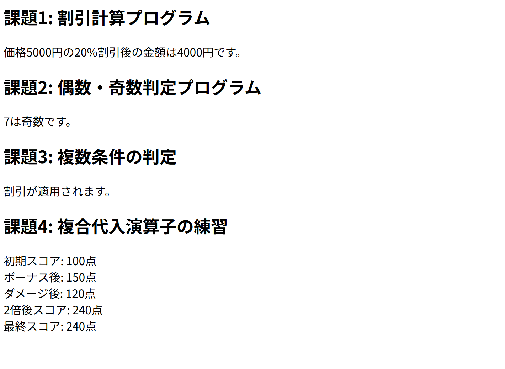

# php-basics-practice

## 概要
COACHTECH 教材 Tutorial 7-1「PHPの基礎 ハンズオン演習」で作成した成果物です。商品の単価と数量や消費税率から合計金額を算出し、各値を画面に表示するためのPHPを作成しました。また追加の課題として、演算やif文による条件分岐、複数条件の組み合わせや複合代入演算子を用いた計算を行うPHPを作成しました。

## 使用技術
- PHP 8.2-fpr
- nginx

## 学んだこと
- 変数は文字列の先頭に「&」を付けて定義し、「=」で値を代入
- 四則演算や比較、論理演算を行うための記号や、演算子の優先順位について学習
- 剰余「%」を利用することで特定の数値の倍数であるかなどの判定が可能
- if文の条件分岐により出力内容を制御

## 動作確認
1. php-practiceディレクトリ上でDocker composeによりnginxコンテナとphpコンテナを起動させてネットワークで連携
2. VSCode上でPHPファイルを編集して保存
3. ブラウザで「`http://localhost:8000/7-1-6_hands-on/practice/price_calculator.php`」のURLにアクセス
4. ブラウザ上で表示内容を確認
5. VSCodeでの編集を保存+ブラウザのリロードで編集内容を確認

## 詰まったポイントと解決方法
- 「echo」で表示する文字列内に変数名を含む場合「echo "変数名は$nameです";」のように記述する変数名が正しく認識されない  
   └「echo "変数名は{$name}です";」のように変数名を「{}」で囲んで解決  
   └または「echo "変数名は" . $name . "です";」のように文字列の連結を活用することでも解決

## 開発の工夫
- コメント機能で何のためのコードなのかを書くことで、各コードの意味を分かりやすく記録
- 「変数の定義」「演算」「結果表示」の場所を明確にしてそれぞれ改行を入れるなどすることで、各コードの集まりの役割を分かりやすくした
- 行のコピペや「Shift+Alt+↓」などにより似たコードを複製することでコードの記述時間を短縮した

## 動作確認のスクリーンショット

